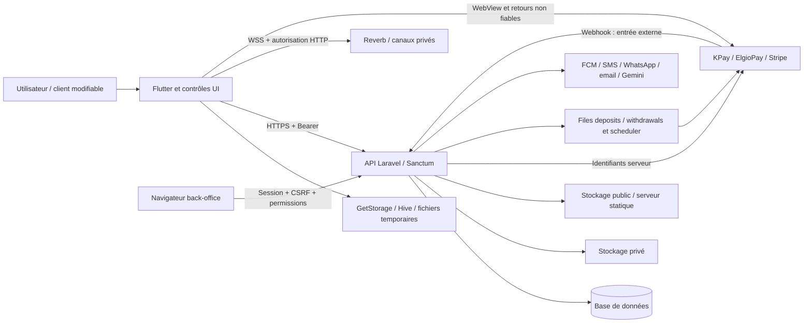

# Audit de cybersécurité — ASSO Mobile et Backend

> Mise à jour mobile : des correctifs ont été appliqués après les phases d'audit décrites ci-dessous. Voir la partie 7 pour leur portée, les tests et les limites. Les constats backend et les descriptions historiques ne constituent pas un état corrigé de la production.

Date : 25 octobre 2026, fuseau Africa/Douala. Phase : audit uniquement, sans correction.

Références de départ : mobile `d8e081c82cfbecc405a62e189b343f05c91b0684` ; backend `c7c9777ca6840e6982909db5648a9f8972cb5d15`.

Conventions : `M/` désigne la racine Asso-Mobile ; `B/` désigne le dépôt adjacent `../Asso-Backend`. Les lignes correspondent aux lectures effectuées pendant l'audit. Le mobile était initialement propre ; des modifications externes d'interface sont apparues pendant l'analyse, notamment des imports AppFeedback décalant certaines lignes. Elles n'ont été ni produites ni annulées par cet audit. Le backend était propre lors des contrôles Git. Ce rapport est la seule création effectuée par l'auditeur.

## Partie 1 — Résumé exécutif

### Conclusion et niveau de risque

**Risque global élevé, avec un chemin critique de compromission de compte conditionné à l'activation d'une liste de bypass OTP.** La plateforme ne peut pas être déclarée suffisamment protégée à partir de cet examen. Des contrôles solides existent sur plusieurs parcours modernes de paiement et de propriété, mais ils coexistent avec des exceptions dangereuses et des routes historiques moins protégées.

Les principaux constats sont :

1. L'API publique délivre un jeton pour un numéro présent dans une liste active de bypass, sans preuve de possession du téléphone ni validation du code. La présence de numéros dans la liste de production n'a pas été interrogée.
2. Un fichier suivi dans Git contient un mot de passe et plusieurs secrets de paiement/webhook renseignés. Leur validité et leur environnement sont inconnus ; aucune authentification n'a été tentée avec ces valeurs.
3. Les routes mobiles d'authentification et de récupération n'ont pas de limitation applicative des tentatives ; le back-office dispose, lui, d'un limiteur.
4. Les codes de plusieurs opérations partagent les mêmes champs OTP. Le changement de téléphone n'attache pas le code à la destination et n'envoie pas effectivement de message dans l'implémentation examinée.
5. Les pièces d'identité Diaspo sont stockées sur le disque public malgré une visibilité métier « restricted ».
6. Deux routes historiques de consultation ne contrôlent pas la propriété : facture par jeton encodé et statut de paiement par référence prestataire.
7. Le jeton mobile est enregistré en JSON sans chiffrement applicatif ; les OTP sont journalisés côté serveur et côté mobile. Les jetons Sanctum émis n'ont pas d'expiration configurée.
8. Les versions verrouillées de Laravel et Symfony correspondent à des avis de sécurité officiels récents ; l'applicabilité varie selon le chemin utilisé.

Composants les plus exposés : authentification publique, documents Diaspo, secrets de paiement, routes historiques de paiement/facturation, stockage et journaux mobiles. Les retraits et règlements sont particulièrement sensibles à une compromission préalable du compte.

### Priorités immédiates proposées, non exécutées

Supprimer le bypass de production et examiner les sessions potentiellement émises par ce chemin ; faire tourner les secrets présents dans Git ; imposer des budgets de tentatives pour OTP/login/reset ; séparer les challenges par opération et destination ; rendre privés les documents Diaspo ; corriger les contrôles de propriété ; mettre à jour les dépendances affectées. Chaque mesure nécessite une phase de correction explicitement autorisée.

### Limites de la conclusion

L'examen est approfondi sur les mécanismes communs et les zones à risque, mais **n'est pas une revue ligne par ligne des 972 fichiers PHP et 466 fichiers Dart suivis**. Il ne certifie ni la conformité MASVS ni la sécurité de la production. Aucun endpoint ASSO, prestataire de paiement, SMTP, Firebase ou base de données réelle n'a été appelé. Aucun paiement, remboursement, transfert, migration, publication, installation ou changement de configuration n'a eu lieu.

Les constatations « confirmées » décrivent le code ou la configuration observés, pas une exploitation constatée en production. Les données, reverse proxies, secrets actifs, IAM, ACL effectives, certificats et applications réellement distribuées n'ont pas été vérifiés.

## Partie 2 — Inventaire et périmètre

### Technologies et composants

| Composant | Éléments identifiés | Portée de l'examen |
|---|---|---|
| Mobile | Flutter/Dart, GetX, application 1.1.0+12 ; configuration SDK Dart ^3.10.4 | Providers, sessions, paiements, WebViews, stockage, configuration native, liens et notifications ciblés |
| Réseau mobile | package:http, Dio, WebSocket Pusher/Reverb | En-tête Bearer partagé, URLs et exceptions, authentification des canaux |
| Persistance mobile | GetStorage 2.1.1, Hive, caches images et PDF temporaires | Jeton/profil, purge de session, snapshots vendeur et brouillons |
| Backend | PHP ^8.2, Laravel verrouillé v12.51.0, Sanctum v4.3.1, Reverb v1.10.0 | Routes API/web/channels, bootstrap, middlewares et contrôleurs/services ciblés |
| Données | Eloquent, tables utilisateurs, rôles, commandes, wallet, documents et réservations | Relations et contrôles applicatifs ; aucune lecture des enregistrements réels |
| Paiements | KPay, passerelle MobileMoneyGateway/ElgioPay, Stripe PaymentIntent/Connect ; service PayPal également présent | Initiation, statut, webhooks, règlements, remboursements et retraits ciblés ; PayPal non revu intégralement |
| Tiers | Firebase/FCM/APNs, WhatsApp/Nexaah, Gemini, conversion de devises, OSM/OSRM | Points d'intégration ; pas d'audit des comptes tiers |
| Documents | dompdf v3.1.5, stockage local privé et public | Factures, identité Diaspo, pièces bailleur et téléchargements immobiliers ciblés |
| Déploiement | Gradle, Xcode, Shorebird, scripts Composer et scripts locaux | Configuration du dépôt ; pas de preuve de la chaîne de livraison effective |

Autres versions : Symfony HttpFoundation v7.4.5 ; stripe/stripe-php v21.2.1 ; Dio 5.9.2 ; webview_flutter 4.13.1 ; flutter_stripe 11.5.0 ; firebase_messaging 15.2.10 ; iOS Firebase 11.15.0 et Stripe 24.7.0 selon Podfile.lock. Composer verrouille 123 dépendances de production et 35 de développement. La présence d'une version ancienne n'est pas, à elle seule, une vulnérabilité.

### Cartographie des frontières de confiance

| Frontière / flux | Données sensibles | Contrôle attendu et observation |
|---|---|---|
| OS → stockage Flutter | Bearer, identité, coordonnées, snapshots vendeur | Sandbox présente ; pas de coffre matériel pour le Bearer : SEC-008 |
| Client → API | IDs, rôles locaux, montants, numéros et codes | Client toujours falsifiable ; Sanctum identifie le compte, chaque fonction doit encore autoriser l'objet |
| API → DB | Stock, prix, soldes et statuts | Transactions/verrous présents dans les parcours récents ; branche historique différente : SEC-013 |
| API → serveur statique | Identité et justificatifs | La visibilité DB ne protège pas un fichier public : SEC-005 |
| Prestataire → webhook | Référence, statut, événement | Signature ou relecture authentifiée ; application différente selon le rail |
| WebView → Flutter | Navigation et messages JavaScript | Indices de fin d'interface uniquement ; l'état serveur doit décider de l'activation |
| Navigateur → administration | Sessions, permissions et opérations de gestion | Middleware backoffice, permissions par route, périmètre AssoScope et CSRF ; pas de validation de toutes les fonctions admin |
| Backend → tiers | Téléphones, emails, contenus, coordonnées, références | Minimisation, secrets serveur, budgets et rétention à contrôler ; audit des prestataires hors périmètre |

### Routes et mécanismes inspectés

Inventaire par familles, issu de `B/routes/api.php`, `web.php` et `channels.php`. Les chemins API sont relatifs à `/api`. Ce tableau ne remplace pas un export exhaustif des routes résolues.

| Routes / famille | Protection déclarée | Vérifications réalisées |
|---|---|---|
| POST `/v1/auth/send-otp`, `verify-otp`, `login`, `register-email`, `login-email`, `verify-email-otp`, `password/forgot`, `password/reset` | Publiques | Validation, bypass, codes, émission/révocation de jetons ; pas de throttle applicatif trouvé |
| POST `/v1/register/send-otp`, `verify-otp` | Publiques | Ancien contrôleur OTP encore routé, bypass et stockage PhoneOtp |
| `/v1/auth/profile`, préférences, locale, changement téléphone, suppression et logout | auth:sanctum | Allowlist de profil, rotation/révocation, absence de challenge dédié au changement téléphone |
| GET `/settings`, `/settings/group/{group}`, `/settings/{key}` | Publiques | Groupes general/system, clés publiques et filtre de secrets ; pas de fuite de secret prouvée par ces routes |
| Catalogue, recherche, boutiques, immobilier public, livraison/partners | Publiques | Lecture des routes, contrôles ciblés ; contacts de sociétés publics ne sont pas automatiquement classés comme fuite |
| POST `/v1/products/analyze` | Publique | Upload image limité à 10 Mo, appel Gemini sans quota applicatif identifié |
| `/v1/orders`, `/{id}`, `payment-status`, `cancel`, `confirm-reception`, `pay-balance` | auth:sanctum | Filtrage user_id et transactions ciblées ; calculs serveur et workflow vendeur |
| `/v1/vendor/orders/*`, `/v1/delivery/*`, synchronisation livreur | auth:sanctum, contrôles dans les fonctions | Appartenance par items/seller_id, affectation livreur/société ; code de synchronisation réutilisable par conception |
| POST `/v1/payments/initiate`, GET `/v1/payments/status/{reference}` | auth:sanctum | Propriété à l'initiation ; absence de propriété sur la lecture par référence |
| `/v1/wallet/*`, retraits KPay/Stripe, statut de recharge | auth:sanctum | Validation montant, propriété recharge, verrou des soldes/retraits et finalisation ciblée |
| `/v1/invoices/package/{token}`, `/pdf/{id}`, `/download/{id}`, `/wallet/{id}/pdf` | auth:sanctum | Propriété présente dans les téléchargements ciblés ; absente dans showPackageInvoice |
| Réservations Diaspo, maritimes et immobilières ; litiges | auth:sanctum | Finalisations et contrôles ciblés ; couverture partielle des transitions et permissions |
| POST `/v1/payments/webhook/kpay`, `/webhooks/kpay` | HMAC KPay | Rejet sans signature/secret ; pas d'horodatage dans le vérificateur ; branche historique non atomique |
| POST `/v1/elgiopay/callback` | throttle:300,1 ; signature conditionnelle | Relecture prestataire dans le job ; traitement admis sans secret dédié |
| POST `/v1/stripe/webhook` | Vérificateur SDK Stripe | Corps brut, secret obligatoire, constructEvent ; finalisations ciblées |
| Broadcasting auth et canaux conversation/utilisateur | auth:sanctum ; callbacks | Participants vérifiés pour conversation ; statut utilisateur ouvert à tout authentifié |
| `/admin/*` | auth + backoffice + admin.submission ; login public | Limites login compte/IP, régénération session, permissions par route et portée gestionnaire |
| `/v1/admin/*` et envois administratifs | Groupes avec api.admin sur les routes inspectées | Contrôle isAdmin ; ancien bloc service-config commenté, pas réputé actif |

Relations sensibles : `User` → tokens/deviceTokens/walletTransactions/walletBalances ; `Order.user_id` → acheteur ; `OrderItem.seller_id` → vendeur ; `delivery_person_id` et `DelivererCodeSync` → coursier/société/agence ; `Conversation.user1_id/user2_id` → participants ; `VendorPackage.user_id` → souscripteur ; `Document.uploaded_by/allowed_users` → détenteurs autorisés ; réservations → client/bénéficiaire. Les rôles principaux incluent client, vendeur, livreur, admin et gestionnaires de back-office ; `getRoles/addRole/hasRole` prennent en charge plusieurs rôles. Le rôle sauvegardé dans Flutter ne constitue pas une autorisation serveur.

### Vérifications et résultats effectivement exécutés

| Vérification | Résultat et limite |
|---|---|
| Inventaire rg/find, lecture numérotée, git status/rev-parse/ls-files | Deux dépôts identifiés ; sources et configurations ciblées lues ; aucune application démarrée |
| Recherche de secrets dans les fichiers suivis | Recherche en mémoire de marqueurs de clés privées, clés Stripe, IDs AWS et tokens GitHub ; aucune valeur affichée. Le fichier `B/compte` a été contrôlé par catégories et présence des champs |
| Historique Git ciblé par noms sensibles | `git log --all --format= --name-only` sur .env, clés/certificats, credentials et compte ; compte retrouvé. Pas de scan exhaustif de tous les blobs historiques ni des objets inaccessibles |
| Analyse de configuration réseau et de persistance | Android main, iOS plist/entitlements, Gradle, providers Flutter, source GetStorage installée lue sans données utilisateur |
| Syntaxe PHP | `php -l` exécuté en lecture seule sur 61 fichiers : contrôleurs API, middlewares et routes ; zéro échec |
| Tests unitaires existants isolés | Depuis B : `php vendor/bin/phpunit --no-configuration --bootstrap vendor/autoload.php --do-not-cache-result --filter 'StripeAmountTest|StripeKeyPairTest|SafeSvgTest' tests/Unit` : **7 tests, 25 assertions réussies**, deux dépréciations PHPUnit. Pas de bootstrap Laravel, de cache de résultats ni de test Feature exécuté |
| Trois vérifications de contrôleurs en mémoire | Sources AuthController/InvoiceController chargées par PHP stdin avec Request, modèles, requêtes, horloge, logs et service facture remplacés par doublures. Bypass → jeton synthétique ; OTP générique → téléphone non lié ; facture → aucun accès au demandeur. Trois contrôles réussis au passage final |
| Limite des doublures | Elles n'exercent ni le routeur, ni Sanctum, ni la validation Laravel réelle, ni SQL. Pour la facture, la requête factice renvoie une fixture sélectionnée : le test prouve le chemin sans consultation du demandeur, pas la possibilité de deviner la référence. Deux premiers essais du harnais ont échoué sur des doublures incomplètes de Carbon puis du type User ; ces défauts du harnais ont été corrigés en mémoire |
| Avis de dépendances | Comparaison des lockfiles avec des avis primaires Laravel/Symfony/Reverb ; aucune mise à jour. Pas de scan automatisé complet Composer/npm/OSV ni d'audit exhaustif CocoaPods/Gradle/Dart |

Les tests Flutter n'ont pas été lancés : plusieurs utilisent `path_provider → '.'` puis GetStorage.erase, et les commandes habituelles créent des artefacts. Les tests Feature Laravel n'ont pas été exécutés : même avec SQLite `:memory:` dans phpunit.xml, certains initialisent stockage, notifications et prestataires. Leur lecture ne vaut pas réussite. Cette restriction respecte la consigne de n'écrire que le rapport.

Tests existants repérés : mobile `login_session_reset_test`, `immo_reservation_documents_test`, `immo_partner_privacy_test`, `payment_exit_test`, `offline_product_queue_test` ; backend `EmailAuthenticationTest`, `StripeWebhookTest`, `StripeWebhookSecretsTest`, `ElgioPayIntegrationTest`, `WalletFlowTest`, `PaymentsWalletMonetizationTest`, `ProductManagerAccessTest`, `AdminDashboardHardeningTest`, `LandlordUploadValidationTest`, tests des réservations/litiges/retraits. Ils constituent une base utile mais ne prouvent pas les propriétés non exécutées.

## Partie 3 — Registre des vulnérabilités

### Convention de preuve et de gravité

**Confirmé** : preuve suffisante dans la source/configuration, avec reproduction locale limitée lorsque précisée. **Probable** : défaut ou combinaison plausible, conséquence finale non démontrée. **À vérifier** : hypothèse ou applicabilité encore non établie. La gravité intègre les préconditions, indépendamment du statut.

Les impacts C/I/D ci-dessous désignent confidentialité/intégrité/disponibilité. Les priorités opérationnelles ne sont pas des scores CVSS. Pour SEC-001, un vecteur CVSS 4.0 est fourni avec hypothèses ; aucun score numérique n'est inventé faute de calculateur validé disponible. Les scores publiés en CVSS 3.x par des fournisseurs ne sont pas convertis implicitement en 4.0.

| ID | Constat | Gravité | Statut | Priorité |
|---|---|---|---|---|
| SEC-001 | Bypass OTP donnant un jeton sans preuve de possession | Critique | Confirmé, condition d'activation inconnue en production | P0 |
| SEC-002 | Identifiants et secrets de paiement présents dans Git | Élevé | Présence confirmée, validité à vérifier | P0 |
| SEC-003 | Authentification et récupération sans budgets de tentatives applicatifs | Élevé | Confirmé dans l'application | P1 |
| SEC-004 | OTP partagé et changement de téléphone sans liaison à la destination | Élevé | Confirmé | P1 |
| SEC-005 | Pièces d'identité Diaspo sur disque public | Élevé | Confirmé ; exposition HTTP effective à vérifier | P1 |
| SEC-006 | Facture consultable sans contrôle du propriétaire | Moyen | Confirmé | P1 |
| SEC-007 | Proxy de statut de paiement sans contrôle de propriété | Moyen | Confirmé | P1 |
| SEC-008 | Bearer et profil dans un stockage JSON sans chiffrement | Moyen | Confirmé | P1 |
| SEC-009 | OTP et données d'authentification dans les journaux | Élevé | Confirmé | P1 |
| SEC-010 | Jetons sans expiration et logout hors ligne non révocateur | Moyen | Confirmé | P1 |
| SEC-011 | Configuration Android permissive en main | Moyen | Confirmé ; effet par pile réseau à tester | P2 |
| SEC-012 | Analyse Gemini publique sans budget applicatif | Moyen | Confirmé ; coût réel à vérifier | P2 |
| SEC-013 | Branche de paiement historique non atomique et divergente | Élevé | Probable pour le double règlement | P1 |
| SEC-014 | Webhook ElgioPay admis sans signature vérifiée selon configuration | Moyen | Confirmé, conditionnel | P2 |
| SEC-015 | Dépendances serveur dans des plages affectées par des avis | Élevé | Versions confirmées ; applicabilité détaillée ci-dessous | P1 |
| SEC-016 | Build release Android pouvant utiliser la signature debug | Faible | Confirmé dans la configuration | P2 |
| SEC-017 | Pagination du wallet sans borne et exceptions internes renvoyées | Moyen | Confirmé ; effet de saturation non testé | P2 |
| SEC-018 | Connexion email avant vérification de l'adresse | Moyen | Confirmé | P1 |

### SEC-001 — Bypass OTP sur liste de numéros actifs

- **Composant/preuves :** `B/app/Http/Controllers/Api/AuthController.php:57–75,137–205`, `B/app/Models/OtpBypassPhone.php:isAllowedToBypass`, routes publiques `B/routes/api.php:53–65`. Une entrée active suffit ; verifyOtp vérifie seulement le format de six caractères avant la branche et appelle createToken sans comparer le code. sendOtp annonce aussi bypass_enabled. Le contrôleur d'inscription historique applique une exception analogue.
- **Scénario/préconditions :** connaître un numéro de compte existant inscrit dans la liste active. Aucune session ou possession WhatsApp/SMS n'est requise. La liste de production n'a pas été consultée.
- **Impact C/I/D :** lecture et actions du compte, fraude selon ses droits, modification voire suppression du compte. Une cible admin/gestionnaire pourrait exposer davantage de fonctions API ; aucun franchissement vers une session web admin n'est prétendu.
- **Vérification sûre :** contrôle en mémoire réussi avec entrée active simulée et code arbitraire. En intégration isolée : fixture A sur liste active, requête publique au code incorrect, attendre refus et zéro jeton créé.
- **Correction :** retirer cette forme de bypass de tous les environnements distribués ; comptes de démonstration séparés sans droits/données réels ; inspecter puis révoquer les sessions suspectes et auditer les changements métier associés.
- **Non-régression :** codes erronés/absents/expirés refusés pour tous les comptes, anciennes routes incluses ; changement de canal ne modifie pas la preuve exigée.
- **CVSS 4.0 proposé :** `CVSS:4.0/AV:N/AC:L/AT:P/PR:N/UI:N/VC:H/VI:H/VA:L/SC:N/SI:N/SA:N`. AT:P représente ici la nécessité d'une liste active préexistante ; impacts limités au compte cible, sans supposer l'accès à un système tiers. Vecteur à revalider selon les droits des comptes effectivement concernés ; score numérique non calculé.

### SEC-002 — Secrets renseignés dans un fichier versionné

- **Composant/preuves expurgées :** `B/compte:1–8`, suivi par Git et retrouvé dans l'historique ciblé. Champs renseignés de type Email/Password aux lignes 1–2, Secret Webhook ligne 4, Secret Gateway ligne 5 et secret key ligne 7. Aucune valeur, préfixe secret ou empreinte de secret n'est reproduit ici. Les champs ne portent pas de marqueur évident de placeholder ; leur validité reste inconnue.
- **Scénario/préconditions :** accès au dépôt, clone, archive ou historique divulgué ; secrets encore utilisables. Ne pas supposer que le dépôt est public.
- **Impact C/I/D :** compromission potentielle d'un compte et d'intégrations de paiement, falsification de webhooks si secret actif, indisponibilité par abus ; étendue dépendant des permissions des identifiants.
- **Vérification sûre :** demander au détenteur, via sa console sécurisée, l'environnement et les droits ; ne pas essayer ces identifiants sur un service réel.
- **Correction :** rotation/révocation auprès de chaque fournisseur et du compte, inventaire des copies et journaux, retrait du fichier puis nettoyage coordonné de l'historique après rotation ; coffre de secrets et détection en CI. La suppression du dernier commit ne suffit pas.
- **Non-régression :** scan des commits et archives, rejet des secrets en précommit/CI, preuve de révocation des anciennes valeurs conservée hors de ce rapport.

### SEC-003 — Absence de limitation des tentatives d'authentification API

- **Composant/preuves :** groupes auth/register publics dans `B/routes/api.php:53–82` ; absence de throttle et de RateLimiter dans leurs contrôleurs ; `B/bootstrap/app.php:15–23` n'appelle pas throttleApi. Le framework installé, `vendor/laravel/framework/src/Illuminate/Foundation/Configuration/Middleware.php:495–498`, n'ajoute throttle que si apiLimiter est renseigné. À l'inverse, le login admin a des limites explicites compte/IP (`Admin/AuthController.php:90–101`).
- **Scénario/préconditions :** appels répétés login ou code à six caractères, récupération, inscription ou SMS. Pas de plafond d'essais par challenge ni budget d'envoi retrouvé. Un éventuel WAF/proxy de production n'a pas été inspecté.
- **Impact C/I/D :** attaques par dictionnaire, recherche de code pendant sa validité, harcèlement et coûts de messages, charge CPU/DB ; compromission finale non exécutée.
- **Vérification sûre :** environnement isolé, fournisseurs factices ; petit plafond de test et constat d'un 429, pas de force brute sur des comptes réels.
- **Correction :** limites coordonnées compte/challenge/IP/appareil, temporisation progressive, quotas d'envoi et protection contre la rotation d'IP ; réponses non énumérantes. Vérifier les proxies de confiance avant de baser les limites sur l'IP.
- **Non-régression :** dépassement contrôlé → 429 et Retry-After, changement de route/canal/IP ne réinitialisant pas le budget de challenge, reprise légitime et non-blocage permanent d'un tiers.

### SEC-004 — Challenge OTP sans finalité ni numéro cible

- **Composant/preuves :** `B/app/Http/Controllers/Api/AuthController.php:528–558,800–868` ; les codes email, login téléphone, reset et changement de numéro utilisent `User.otp_code/otp_expires_at`. requestPhoneChange génère et conserve un code mais ne conserve pas le numéro cible et n'appelle aucun service d'envoi avant la réponse. confirmPhoneChange accepte le code courant de l'utilisateur pour le numéro fourni à ce second appel, sans recontrôle d'unicité dans cette fonction.
- **Scénario/préconditions :** utilisateur authentifié possédant un OTP valide d'un autre parcours, par exemple reçu à son email. Il peut attacher un numéro non contrôlé sans challenge envoyé à ce numéro. Avec session compromise, les champs d'identité deviennent plus faciles à détourner. Une collision avec un numéro déjà utilisé peut être bloquée par la contrainte DB ; aucun vol de numéro existant n'est affirmé.
- **Impact C/I/D :** intégrité de l'identité téléphonique, récupération et notifications détournées ; récupération possible du compte par le véritable détenteur du numéro ultérieurement. Disponibilité du parcours légitime dégradée par l'absence d'envoi.
- **Vérification sûre :** contrôleur reproduit en mémoire avec OTP générique préexistant et numéro synthétique ; intégration à compléter avec faux email/SMS et contraintes SQL réelles.
- **Correction :** challenges indépendants, finalité/destinataire/compte/expiration/compteur et consommation atomique ; envoi réel au numéro stocké ; confirmation ne prenant plus une nouvelle destination ; unicité vérifiée sous transaction ; réauthentification pour changement d'identifiant.
- **Non-régression :** OTP de reset/inscription refusé pour changement téléphone, substitution de destination refusée, code consommé une seule fois, collision concurrente refusée sans erreur interne.

### SEC-005 — Identité Diaspo enregistrée sur disque public

- **Composant/preuves :** `B/app/Http/Controllers/Api/DiaspoOfferController.php:355–380` utilise storeAs(..., 'public') pour identité/résidence/voyage, tout en écrivant visibility=restricted et allowed_users. `B/config/filesystems.php` définit le disque public et le lien public/storage. La restriction SQL n'est pas évaluée par un serveur statique. Les pièces bailleur utilisent au contraire le disque local privé.
- **Scénario/préconditions :** URL de fichier obtenue dans une réponse, un journal, une copie ou par partage, et stockage public exposé comme prévu. Le nom contient un suffixe aléatoire ; aucune énumération facile n'est supposée. La configuration HTTP distante n'a pas été sollicitée.
- **Impact C/I/D :** divulgation durable de pièces d'identité et justificatifs ; risque d'usurpation secondaire ; pas de modification de fichier démontrée.
- **Vérification sûre :** upload factice sur une instance isolée et lecture anonyme du fichier ; aucun téléchargement de pièce réelle.
- **Correction :** stockage privé et téléchargement autorisé par objet, URLs signées brèves si nécessaire ; retirer les copies publiques existantes et caches associés avec traçabilité, politique de conservation et suppression.
- **Non-régression :** fichier absent de public/storage, anonyme/autre compte refusés, propriétaire/admin autorisés selon besoin, suppression et expiration effectives.

### SEC-006 — Facture par jeton encodé sans autorisation objet

- **Composant/preuves :** `B/app/Http/Controllers/Api/InvoiceController.php:27–59` décode base64(id:payment_reference), recherche le package et génère la facture sans consulter le demandeur. Route auth:sanctum à `B/routes/api.php:324–329`. `B/app/Services/InvoiceService.php:26–35,72–75` inclut nom/email/téléphone et construit ce jeton sans expiration. Les autres fonctions de téléchargement contrôlent user_id.
- **Scénario/préconditions :** un compte authentifié obtient le lien ou le couple ID/référence d'un autre souscripteur. L'entropie de payment_reference n'est pas traitée comme une autorisation ; aucune possibilité de deviner toutes les références n'est démontrée.
- **Impact C/I/D :** divulgation des coordonnées et montants d'une facture ; I/D non démontrés.
- **Vérification sûre :** chemin sans demandeur confirmé par doublures ; test HTTP A/B à ajouter avec facture synthétique et référence connue de B.
- **Correction :** filtrer par user_id ou policy avant génération ; si partage explicite voulu, utiliser une capacité signée expirante, révocable et limitée aux données nécessaires.
- **Non-régression :** A propriétaire autorisé, B avec le lien exact refusé, anonyme refusé, variantes PDF/download/JSON cohérentes.

### SEC-007 — Statut prestataire accessible sans rattachement au compte

- **Composant/preuves :** `B/app/Http/Controllers/Api/PaymentController.php:195–204` passe directement reference à MobileMoneyGateway et renvoie result.data ; route protégée `B/routes/api.php:301`. `B/app/Services/KPayService.php:156–183` relit le paiement avec les identifiants serveur et restitue son objet prestataire. Aucun filtre user_id dans ce chemin, contrairement au statut wallet (`WalletController.php:1173–1180`).
- **Scénario/préconditions :** compte authentifié et référence prestataire appartenant à un autre utilisateur du compte marchand. Les détails exposés dépendent de la réponse fournisseur ; aucun champ personnel précis n'est affirmé sans capture de test.
- **Impact C/I/D :** statut et métadonnées de paiement d'un tiers, appels fournisseur facturables/charge ; pas d'ordre de transfert démontré par cette route.
- **Vérification sûre :** mock prestataire, deux comptes et deux références connues ; vérifier que la référence de B n'est jamais appelée par A.
- **Correction :** résoudre la référence via un objet local possédé et ne retourner qu'un DTO minimal ; retirer la route si historique inutilisé.
- **Non-régression :** refus avant tout appel externe pour référence étrangère/inconnue ; absence de corps fournisseur brut dans JSON.

### SEC-008 — Jeton d'accès et profil persistés sans coffre sécurisé

- **Composant/preuves :** `M/lib/app/data/providers/storage_service.dart:10,30–36,80–89` stocke token/profil dans GetStorage. La source installée get_storage-2.1.1 `lib/src/storage/io.dart:34–52` écrit du JSON UTF-8 et une sauvegarde JSON ; aucune protection Keychain/Keystore ajoutée. Hive ouvre aussi ses boîtes sans encryptionCipher (`offline_store.dart:40–64`) ; ce point concerne les snapshots/brouillons, pas un second jeton identifié.
- **Scénario/préconditions :** lecture du conteneur de l'application, sauvegarde récupérable, appareil compromis ou accès équivalent. Un simple autre utilisateur Android non privilégié ne peut pas lire automatiquement la sandbox.
- **Impact C/I/D :** vol de session/profil puis actions avec le Bearer ; disponibilité indirecte du compte. L'absence de chiffrement applicatif n'implique pas absence de chiffrement du disque OS.
- **Vérification sûre :** compte factice sur émulateur autorisé, inspection du conteneur et de GetStorage.bak ; jamais de token réel dans la sortie.
- **Correction :** coffre Keychain/Keystore pour le jeton, migration/purge des anciennes copies et du backup ; minimiser/chiffrer les snapshots sensibles et définir la rétention ; règles de sauvegarde adaptées.
- **Non-régression :** recherche de token synthétique absente des fichiers JSON/backups, logout et migration nettoyant les copies, redémarrage conservant correctement une session autorisée.

### SEC-009 — Journalisation de codes d'authentification et d'identité

- **Composant/preuves :** `B/app/Http/Controllers/Api/AuthController.php:78–85,144–146,245–254` journalise des OTP complets sans condition local/debug. `M/lib/app/data/providers/auth_service.dart:80–84,113–118` journalise le code soumis, le téléphone et les vingt premiers caractères du jeton ; d'autres branches email reproduisent des traces analogues. StorageService journalise également le profil. Les logs WebView peuvent contenir URLs et messages de paiement.
- **Scénario/préconditions :** accès aux journaux backend encore chauds, exports de support ou collecte mobile. Les traces developer.log/print ne garantissent pas toutes une visibilité identique en release : celle-ci doit être mesurée. Les vingt caractères seuls ne sont pas présentés comme un jeton complet exploitable.
- **Impact C/I/D :** OTP utilisable pendant sa validité et données personnelles divulguées ; compromission conditionnelle du compte. L'absence de budget SEC-003 augmente le risque.
- **Vérification sûre :** injecter marqueurs synthétiques, capturer les logs d'un build de test/release et contrôler leur absence, sans lire les journaux clients réels.
- **Correction :** supprimer codes, morceaux de jetons, corps de réponses sensibles et PII superflues ; filtrage central, accès restreints, rétention courte et traitement des copies historiques.
- **Non-régression :** aucun marqueur OTP/token/client_secret dans logs/stdout/rapports d'erreurs ; événements de sécurité conservés sous IDs non sensibles.

### SEC-010 — Sessions mobiles à durée indéfinie et révocation perdue hors ligne

- **Composant/preuves :** `B/config/sanctum.php` expiration=null ; createToken('mobile-app') sans expires_at dans AuthController. Aucun mécanisme de refresh observé : il s'agit de jetons opaques Sanctum, pas nécessairement de JWT. Logout serveur révoque le jeton courant (`AuthController.php:782–783`) et resetPassword révoque tous les jetons (`:557–558`). Le client efface sa session quel que soit le résultat de logout (`M/.../auth_service.dart:702–725`), sans reprise persistée de révocation.
- **Scénario/préconditions :** jeton préalablement copié ; logout local pendant indisponibilité réseau. Le jeton effacé du client reste valide côté serveur jusqu'à une révocation ultérieure ; un effacement local n'est pas une révocation.
- **Impact C/I/D :** prolongation de l'accès d'un détenteur non autorisé, actions du compte selon droits ; pas de défaillance de la révocation réussie prétendue.
- **Vérification sûre :** API isolée, deux clients et proxy simulant panne ; réutiliser uniquement un jeton synthétique après logout échoué.
- **Correction :** durée maximale bornée et renouvellement maîtrisé ou réauthentification ; gestion/listage/révocation des appareils ; stratégie explicite de logout hors ligne ; réauthentification pour retrait/changement d'identité/suppression. Ne pas introduire un refresh token permanent non sécurisé.
- **Non-régression :** expiration, logout réussi, reset global, autres appareils, panne réseau et anciens jetons après changement de téléphone.

### SEC-011 — Politique réseau Android de développement appliquée au main

- **Composant/preuves :** `M/android/app/src/main/AndroidManifest.xml:22–23` autorise cleartext et référence `network_security_config.xml:4–7` qui autorise HTTP globalement et fait confiance aux CA utilisateur. Pas d'override release identifié. La ligne 17 contient une URL complète comme domaine, au lieu d'un hostname ; cette entrée ne constitue pas une restriction valide de l'API.
- **Scénario/préconditions :** contenu HTTP chargé par une pile respectant cette politique, ou CA ajoutée par l'utilisateur sur la pile native concernée et interception réseau. API et WebSocket visent HTTPS/WSS par défaut. Les piles dart:io/Dio et WebView n'appliquent pas nécessairement les règles Android de manière identique : interception de tout le trafic Dart non affirmée.
- **Impact C/I/D :** divulgation/modification sur les flux concernés ; pas de contournement badCertificateCallback/HttpOverrides trouvé dans lib lors de la recherche.
- **Vérification sûre :** build release de test, serveur HTTP local et proxy à CA de test, matrice http/Dio/WebView/médias ; aucun proxy sur production.
- **Correction :** interdire HTTP et CA utilisateur en release, exceptions debug limitées ; refuser les surcharges API_BASE_URL/WS_TLS non sûres dans les builds distribués.
- **Non-régression :** échec de HTTP et certificats non approuvés sur chaque pile. Le pinning n'est pas une exigence automatique : évaluer rotation, clés de secours et impact d'indisponibilité avant adoption.

### SEC-012 — Ressource d'analyse Gemini publique sans budget

- **Composant/preuves :** route publique POST `/v1/products/analyze` dans `B/routes/api.php` ; `AnalyzeProductController.php:29–58` accepte une image jusqu'à 10 Mo et appelle GeminiService ; `GeminiService.php:24–43` lit/encode le fichier et effectue generateContent. Aucun quota compte/IP/concurrence spécifique identifié sur ce parcours.
- **Scénario/préconditions :** requêtes anonymes valides, intégration Gemini configurée et utilisable. La disponibilité réelle du modèle distant et les quotas fournisseur sont inconnus.
- **Impact C/I/D :** coûts ou épuisement du quota partagé, mémoire/CPU et indisponibilité de l'assistance produit ; pas d'extraction de données démontrée.
- **Vérification sûre :** mock Gemini, petit budget et appels bornés ; ne pas consommer l'API réelle pour prouver le risque.
- **Correction :** authentification selon besoin métier, quota utilisateur/IP, bornes pixels/octets, concurrence contrôlée, timeout et plafond de dépense fournisseur.
- **Non-régression :** 429 et arrêt avant appel tiers au-delà du budget ; formats invalides refusés ; absence de retry incontrôlé.

### SEC-013 — Ancien flux de paiement encore routé, sans finalisation atomique

- **Composant/preuves :** `B/app/Http/Controllers/Api/PaymentController.php:99–165` crée encore des Transaction via initiate ; branche webhook `:329–395` lit pending, puis met completed et incrémente pending_earnings sans transaction/verrou couvrant l'ensemble. Elle force aussi status=confirmed, contrairement au flux moderne qui attend la validation vendeur. Le commentaire « injoignable pour les commandes actuelles » ne retire pas la route initiate. Le HMAC KPay `KPayService.php:334–345` n'inclut aucun horodatage ou registre de rejeu.
- **Scénario/préconditions :** une commande/transaction atteignant cette branche, puis livraison concurrente d'un même événement signé valide. Un attaquant ne peut pas forger ce HMAC sans secret. L'existence de transactions concernées en production et la double écriture réelle n'ont pas été vérifiées.
- **Impact C/I/D :** double incrément potentiel de gains historiques, paiement traité dans un workflow divergent, stocks/règlements à réconcilier. La possibilité de retirer ces gains historiques n'est pas établie ; aucune perte monétaire chiffrée affirmée.
- **Vérification sûre :** base de test transactionnelle réelle, passerelle simulée, événement signé avec secret de test livré à deux workers synchronisés ; jamais de prestataire réel.
- **Correction :** retirer l'initiation historique si inutile, migrer la logique vers une finalisation commune ; verrou et contrôle d'état internes, journal d'événements unique et idempotence métier ; rapprochement montant/devise/référence.
- **Non-régression :** duplications séquentielles et concurrentes, webhook/polling simultanés, événements anciens/désordonnés, panne après mise à jour de statut, commande annulée ; une seule conséquence comptable.

### SEC-014 — Admission conditionnelle de webhooks ElgioPay non authentifiés

- **Composant/preuves :** `B/app/Http/Controllers/Api/ElgioPayWebhookController.php:28–34,65–73` ne rejette une signature invalide que si hasDedicatedWebhookSecret est vrai. Sans secret dédié, le contrôleur met en cache un eventId fourni ou dérivé et planifie le job. `ProcessElgioPayEventJob.php:53–86` et les finalisations relisent le prestataire : le corps non signé ne suffit donc pas à créditer un wallet.
- **Scénario/préconditions :** configuration sans secret dédié ; appels publics avec événements/références variés. La route a throttle:300,1 ; pas de charge illimitée par IP supposée, mais abus distribué et amplification dans les files restent possibles. Un eventId choisi peut également perturber le dédoublonnage.
- **Impact C/I/D :** file/cache/API prestataire sollicités sans authentification ; traitement retardé ou événement temporairement masqué. Crédit frauduleux direct non démontré.
- **Vérification sûre :** faux prestataire et fausse queue, configuration sans secret puis avec secret ; contrôler zéro job pour un appel non authentifié après correction.
- **Correction :** secret dédié obligatoire en production avec échec fermé ; si contrat prestataire l'empêche, mécanisme de déclenchement explicitement restreint, budget global/concurrence et dédoublonnage non contrôlé par l'appelant.
- **Non-régression :** signature absente/fausse/périmée, rotation de secret, relecture indisponible, événement dupliqué et eventId forgé ; aucun crédit sans confirmation distante.

### SEC-015 — Versions verrouillées affectées : applicabilité à distinguer

- **Composant/preuves :** `B/composer.lock` verrouille Laravel v12.51.0 et HttpFoundation v7.4.5. La regex de `B/vendor/symfony/http-foundation/HeaderUtils.php:53–69` et son appel par HeaderBag correspondent au chemin décrit dans l'avis ReDoS. Les avis primaires ont été consultés le jour de l'audit ; pas de test de déni de service exécuté.
- **Scénario/préconditions et statut :** tableau ci-dessous. Une présence de version affectée est confirmée ; une exploitation complète de l'application n'est pas automatiquement confirmée.
- **Impact C/I/D :** indisponibilité par parsing d'en-têtes ; manipulation des emails selon transport ; autres impacts conditionnés aux fonctions effectivement exposées.
- **Correction :** mettre à jour vers des versions compatibles corrigeant tous les avis applicables, au minimum Laravel 12.69.0 et HttpFoundation 7.4.19 pour les avis listés, puis réaliser un audit complet de tous les lockfiles. Ces minima ne garantissent pas l'absence d'autres avis.
- **Vérification sûre/non-régression :** résolution dans un environnement de travail autorisé, scan des locks, tests auth/email/documents/routes ; petit test de parsing à budget CPU strict en isolation, sans trafic de charge ; confirmer les versions du vendor déployé et des artefacts.

| Avis primaire | Comparaison et applicabilité |
|---|---|
| [Symfony GHSA-r925-mgvr-h9cc](https://github.com/symfony/symfony/security/advisories/GHSA-r925-mgvr-h9cc) | v7.4.5 dans la plage affectée, correctif 7.4.19. Parsing de Cache-Control à la construction des requêtes : chemin présent ; saturation distante non testée. Risque élevé |
| [Laravel GHSA-5vg9-5847-vvmq](https://github.com/laravel/framework/security/advisories/GHSA-5vg9-5847-vvmq) | v12.51.0 <12.60.0 ; registerEmail valide email puis Mail::to. Applicabilité probable, dépendante de Symfony Mailer/Mime et du transport ; aucun email envoyé |
| [Laravel GHSA-crmm-hgp2-wgrp](https://github.com/laravel/framework/security/advisories/GHSA-crmm-hgp2-wgrp) | v12.51.0 <12.61.1 ; local serve=true, mais pas d'appel temporaryUrl/temporaryUploadUrl retrouvé dans app. Exploitation à vérifier, pas de contournement de documents déclaré |
| [Laravel GHSA-5wcm-3v2w-8362](https://github.com/laravel/framework/security/advisories/GHSA-5wcm-3v2w-8362) | Version dans la plage indiquée ; pas de relation dynamique issue de paramètres include retrouvée par la recherche ciblée. Applicabilité à vérifier ; aucun test destructif |
| [Laravel GHSA-f9x3-7vq9-cph6](https://github.com/laravel/framework/security/advisories/GHSA-f9x3-7vq9-cph6) | Version dans la plage affectée, mais avis visant TokenGuard ; configuration inspectée : web/session et auth:sanctum, aucun guard driver=token trouvé. **Pas de bypass critique imputé à cet avis** dans la configuration observée |
| [Laravel GHSA-jh5r-qr3c-85q8](https://github.com/laravel/framework/security/advisories/GHSA-jh5r-qr3c-85q8) | v12.51.0 <12.69.0 ; nécessite page debug et interaction. Faible, déploiement à vérifier |
| [Reverb GHSA-m27r-m6rx-mhm4](https://github.com/laravel/reverb/security/advisories/GHSA-m27r-m6rx-mhm4) | Affecte <1.7.0 ; version verrouillée 1.10.0 hors plage : **non retenu** |

### SEC-016 — Signature debug de secours pour release Android

- **Composant/preuves :** `M/android/app/build.gradle.kts:63–69` choisit signingConfigs.debug lorsque la configuration release n'existe pas. Minification désactivée également, ce qui n'est pas à lui seul une vulnérabilité.
- **Scénario/préconditions :** construction puis distribution d'un APK release depuis un environnement sans key.properties ; aucune preuve que l'APK distribué a cette signature. La clé debug n'est pas nécessairement identique sur tous les postes.
- **Impact C/I/D :** affaiblissement de la provenance/reproductibilité et risque de distribution incorrecte ; remplacement malveillant nécessitant aussi la clé correspondante et un canal d'installation. Aucun bypass distant automatique.
- **Vérification sûre :** inspection du certificat d'un artefact de test/production fourni, sans reconstruire ni signer pendant cet audit.
- **Correction :** échec de la tâche release sans signature approuvée, contrôle CI du certificat attendu et séparation des canaux debug/release.
- **Non-régression :** release sans secret de signature échoue ; empreinte d'artefact comparée à la politique de distribution.

### SEC-017 — Pagination non bornée et erreurs techniques retournées

- **Composant/preuves :** `B/app/Http/Controllers/Api/WalletController.php:62–86` transmet per_page sans validation/bornage ; `B/app/Services/WalletService.php:399–411` l'utilise dans paginate et charge payment/admin. Les catch de WalletController et SettingController renvoient getMessage sans condition app.debug.
- **Scénario/préconditions :** compte authentifié avec historique important, requête per_page excessive ou donnée provoquant une erreur ; le contenu technique dépend de l'exception. Les routes settings sont publiques. Aucun volume ni message de production examiné.
- **Impact C/I/D :** mémoire/DB/bande passante excessive et divulgation éventuelle de schéma/chemins ; SQL injection non démontrée. Les relations chargées doivent aussi être minimisées, sans présumer qu'elles exposent un secret.
- **Vérification sûre :** fixtures bornées et requêtes per_page=0/négatif/texte/au-delà du plafond ; exceptions simulées, pas de test massif.
- **Correction :** schéma d'entrée strict avec plafond, DTO de transactions minimal, messages externes stables et identifiant de corrélation ; exception technique réservée aux journaux protégés.
- **Non-régression :** limites respectées, types invalides refusés, absence de détails internes/secrets dans réponses 4xx/5xx, accès limité au compte.

### SEC-018 — Vérification email contournable par login direct

- **Composant/preuves :** `B/app/Http/Controllers/Api/AuthController.php:385–435` crée un compte avant vérification email et envoie un code ; loginEmail `:443–469` vérifie seulement email/password puis crée un jeton. Aucun test email_verified_at ni middleware verified sur le groupe API inspecté.
- **Scénario/préconditions :** inscription avec une adresse non possédée encore disponible, envoi email accepté, puis login direct avec le mot de passe choisi. Ne compromet pas un compte déjà existant puisque registerEmail refuse les emails déjà inscrits.
- **Impact C/I/D :** compte actif attaché à une identité email non prouvée, messages indésirables et préinscription d'une adresse de tiers ; les opérations supplémentaires dépendent de leurs propres contrôles.
- **Vérification sûre :** Mail::fake, inscription A avec email factice, login sans OTP et appel d'une route nécessitant identité vérifiée. Démonstration ici par lecture du contrôle, pas par création de compte.
- **Correction :** état de préinscription et jeton restreint si nécessaire ; refus des sessions pleinement actives avant vérification ; gérer explicitement changement d'adresse et nouvelle vérification.
- **Non-régression :** email non vérifié refusé, code correct active le compte, mail échoué ne laisse pas un compte actif, connexions téléphone légitimes non régressées.

### Points positifs vérifiés dans la source et limites restantes

- `OrderController.show/paymentStatus/cancel` filtrent user_id ; `VendorOrderController.getVendorOrder/show` filtre seller_id ; les conversations et leurs canaux vérifient les participants. L'authentification globale n'est donc pas le seul contrôle partout. Pas d'IDOR généralisé affirmé.
- `OrderService.createOrder/createWholesaleOrder` relit les produits/prix et verrouille produits/variantes ; le montant Flutter n'est pas la seule source de vérité. Les devises et conversions sont traitées côté serveur sur les parcours examinés. Les arrondis, totaux multi-devises et commissions de tous les modules ne sont pas certifiés.
- `confirmBySeller` exige payment_status=paid et verrouille la commande ; `settleOrder/refundBuyer` relisent sous verrou. Les crédits de recharge modernes ont des verrous et états terminaux. Ceci ne prouve pas l'absence de toutes courses entre rails, files et jobs.
- KPay rejette signature/secret absents ; Stripe utilise le vérificateur SDK sur le corps brut avec secret obligatoire ; les recharges modernes relisent le prestataire. La validité de leurs secrets déployés et le rapprochement systématique montant/devise/compte marchand restent à tester.
- Les fichiers bailleur utilisent le disque privé ; les documents de réservation immobilière ont un contrôle d'accès et un téléchargement authentifié. Aucun accès anonyme effectif n'a été tenté.
- Le profil utilise une allowlist (`AuthController.updateProfile`) excluant rôles et soldes ; pas de mass assignment de rôle confirmé sur ce chemin. Les fonctions utilisant `$fillable` restent à vérifier individuellement.
- Android expose MainActivity pour launcher/liens ; cela est attendu. DeepLinkService vérifie le domaine et convertit l'identifiant produit en entier. Les fichiers d'association servis, le manifeste fusionné et les comportements intents réels n'ont pas été testés.
- iOS n'autorise pas globalement NSAllowsArbitraryLoads dans le plist inspecté ; NSAllowsLocalNetworking est présent. Autorisations caméra/localisation/photos/micro déclarées ; pas de preuve de permission excessive exploitable. La permission « always » mérite d'être rapprochée du besoin réel.
- Aucun contournement TLS explicite badCertificateCallback/HttpOverrides trouvé dans lib ; absence de pinning non classée comme vulnérabilité.
- Clés Firebase client, application ID Reverb et publishable_key Stripe sont des identifiants publics par conception ; pas assimilés aux secrets serveur. Les règles/IAM Firebase et restrictions d'usage n'ont pas été auditées.

### Hypothèses et validations complémentaires hors registre confirmé

| Sujet | État et vérification attendue |
|---|---|
| WebViews paiement | JavaScript non restreint, canaux FlutterPayment/PaymentResult et reconnaissance de sous-chaînes status=success sans contrôle d'origine. Une page arbitraire peut influencer l'interface ; crédit serveur frauduleux non démontré. Tester tous les appelants avec page locale malveillante et polling serveur négatif ; ne jamais activer un service sur ce seul retour |
| WebView facture | Envoie Bearer à invoiceUrl sans validation locale d'origine, navigation/JS permissifs. URLs de facture contrôlées par serveur dans les parcours inspectés ; capacité d'un attaquant à imposer cette URL non démontrée. Tester liste d'origines, redirections et bridge avec fixtures |
| Sauvegardes/captures | Pas de règles allowBackup/dataExtraction/fullBackup ou FLAG_SECURE retrouvées dans les sources natives inspectées. Effet du manifeste fusionné et sauvegardes OS à examiner sur artefact signé ; définir protection ciblée des écrans wallet/KYC selon menace, sans bloquer systématiquement les captures |
| Rétention locale | Snapshots/brouillons Hive persistent par compte, sans purge de déconnexion identifiée ; séparation par user ID et filtrage de synchronisation présents. Pas de fuite intercompte démontrée. Définir rétention et tester changement de compte, suppression et sauvegardes |
| Sessions en mémoire | Logout explicite appelle SessionReset ; le traitement partagé d'un 401 efface auth/cache et coupe WebSocket mais ne passe pas par toute la purge des contrôleurs. Tester écran ouvert après 401 et requête A terminant après connexion B ; fuite non démontrée |
| Proxy et CORS | trustProxies('*') dans bootstrap : fiabilité de X-Forwarded-* dépendant du réseau frontal ; liste des proxies et filtrage en entrée inconnus. Pas de config cors dédiée trouvée ; pas de contournement CORS/CSRF affirmé |
| Présence temps réel | user.status.{userId} autorise tout utilisateur authentifié. À rapprocher du modèle de confidentialité prévu ; limiter aux relations autorisées si la présence est privée |
| Uploads/injections | Validation MIME/taille présente sur plusieurs chemins ; SafeSvg testé. Aucun SQLi, traversal ou RCE confirmé. Étendre aux vidéos/ffmpeg, HTML/Markdown back-office, imports, documents et noms de fichiers avec corpus inerte |
| Déploiement et infrastructure | Pas d'audit des IAM/comptes de service, serveur web, ACL de buckets, Redis, workers, sauvegardes, Docker effectif ou protection CI. Pas de workflow de sécurité dédié identifié dans les fichiers inventoriés ; absence de contrôle externe non prouvée |
| Secrets et .env | .env local backend présent et non suivi selon l'inventaire courant/historique ciblé ; champs sensibles inspectés sans valeurs. Sa configuration n'est pas une preuve de celle de production. Pas de scan exhaustif de toutes les anciennes valeurs, branches distantes non récupérées ou bundles compilés |

## Partie 4 — Plan de remédiation priorisé

Ce plan est une proposition. Aucune action ci-dessous n'a été exécutée.

| Lot / ordre | Travail | Responsable suggéré | Dépendances et preuve de clôture |
|---|---|---|---|
| 0 — confinement après autorisation | SEC-001 : retirer les chemins de bypass ; examiner comptes/listes/sessions, révoquer les sessions concernées. SEC-002 : rotation des identifiants/secrets et revue des usages | Backend + exploitation + détenteurs des comptes fournisseurs | Identifier propriétaires et consommateurs avant rotation ; prévoir chevauchement contrôlé des secrets webhooks si nécessaire. Preuves : bypass refusé, anciennes valeurs révoquées, rapprochement des événements suspects |
| 1 — identité et autorisations | SEC-003/004/018 : budgets, challenges par finalité/destinataire et vérification email ; SEC-006/007 : policies et résolutions locales possédées ; réauthentification des opérations sensibles | Backend | Coordination du contrat mobile et de l'état des comptes existants ; tests A/B/rôles et anciens endpoints avant déploiement |
| 2 — transactions et événements | SEC-013 : retirer/converger le legacy, finalisations atomiques ; SEC-014 : authentifier admission et protéger les files ; rapprochement montant/devise/prestataire/compte et idempotence métier | Backend paiements + exploitation | Avant suppression legacy, inventaire des transactions non terminales, sans migration exécutée dans cet audit. DB de test réaliste et prestataires factices ; une seule conséquence par paiement/événement |
| 3 — secrets et données | SEC-005/008/009/010 : documents privés, suppression des copies publiques, coffre mobile, nettoyage des logs, durée/revocation sessions et rétention | Backend + mobile + exploitation | Migration sécurisée du stockage existant à concevoir ; ne pas perdre documents/brouillons et sessions légitimes. Révocation serveur coordonnée avec sortie du coffre mobile |
| 4 — dépendances et durcissement | SEC-015/011/016/017 : mises à jour compatibles, politique réseau release, signature obligatoire, limites pagination et DTO d'erreurs | Backend + mobile + CI | Lot dépendances peut avancer en parallèle du lot 1 ; ne pas différer la fermeture du bypass en attendant une mise à jour majeure. Validation sur artefacts signés et scan complet des locks |
| 5 — améliorations | Matrice d'accès exhaustive, observabilité sans secrets, restrictions WebView, sauvegardes et captures ciblées, droits des services, revue CORS/proxy, surveillance financière | Équipe sécurité + produit + exploitation | Threat model validé et environnements de test isolés ; couverture démontrée des zones restantes |

Priorité temporelle proposée : lot 0 à traiter immédiatement après autorisation, lots 1–2 avant toute extension des usages financiers, lots 3–4 au prochain cycle de sécurité prioritaire. Ces horizons ne constituent pas une garantie de délai. Le propriétaire des paiements doit valider les contrôles de rapprochement et les procédures de rotation ; l'audit ne déclenche aucune transaction d'essai réelle.

Les corrections critiques exigent une relecture croisée des anciennes routes : fermer seulement l'écran Flutter ou seulement `/v1/auth/*` en laissant `/v1/register/*` ne suffit pas. Le nettoyage Git doit suivre la rotation des secrets. Le déplacement des documents doit traiter les anciennes copies et caches. Les nouvelles limites IP doivent tenir compte du frontal de confiance.

## Partie 5 — Stratégie de tests de sécurité

### Environnement et règles d'exécution

Préparer un environnement isolé explicitement autorisé, une base éphémère, des fichiers et identités fictifs. Imposer des doublures pour HTTP, email, Firebase, Stripe/KPay/ElgioPay et bloquer toute sortie réseau non prévue. Aucune clé de production ; files dédiées et horloge contrôlée. Pour la concurrence, utiliser le même moteur SQL que la production sur une instance jetable : SQLite mémoire ne reproduit pas les verrous MySQL/PostgreSQL. Les seuls tests exécutés pendant cette phase sont ceux décrits en Partie 2.

### Matrice d'autorisation et isolation

Pour chaque opération lecture/écriture/document/transition : tester anonyme, compte A propriétaire, compte B de même rôle, rôle différent, vendeur d'une autre boutique, livreur non affecté/banni/désynchronisé, gestionnaire restreint, admin. Vérifier statut et absence d'effets DB, fichiers, messages et appels prestataires. IDs exacts de B connus des tests : l'impossibilité de deviner un ID ne doit jamais faire réussir le test.

Couverture prioritaire : commandes et lignes multivendeurs, factures JSON/PDF, statut par référence, wallet/retraits/comptes de versement, documents KYC/réservation, conversations, réservations Diaspo/maritimes/immobilières, litiges et administration. Vérifier les propriétés retournées, pas seulement le statut HTTP : absence de PII/soldes/métadonnées d'un tiers.

### Scénarios à ajouter et critères attendus

| Domaine | Cas de tests | Critère de sécurité |
|---|---|---|
| Authentification OTP | Bypass actif/inactif, code incorrect/expiré/déjà consommé, envois multiples, ancien endpoint, caractères/longueurs invalides | Aucun jeton sans preuve réelle ; challenge consommé atomiquement ; limites persistantes |
| Finalité des codes | Code login → reset ; code reset → vérification email ; code email → changement téléphone ; substitution destination | Chaque code lié à une finalité, au compte et à la destination ; échanges refusés |
| Vérification email | Login immédiat après inscription, email jamais vérifié, modification email, échec SMTP simulé | Accès sensible seulement après vérification ; états intermédiaires maîtrisés |
| Sessions | Jeton expiré, logout confirmé/échoué/hors ligne, reset, changement identité, révocation d'un appareil, 401 non JSON | Révocation et durée effectives ; autres sessions conformes à la politique ; purges de l'interface |
| Course de sessions mobile | Requête A en vol, logout, connexion B puis réponse A ; notification et WebSocket d'A après bascule | Aucun état/caching/événement d'A visible sous B ; callbacks associés à une génération de session |
| Workflows | Paiement pending puis validation vendeur, annulation puis succès tardif, livraison non affectée, confirmation hors ordre, litige/remplacement/réception répétés | Transitions serveur explicites ; aucun crédit sans encaissement ; invariants stock/solde conservés |
| Montants et devises | Prix Flutter falsifié, quantité négative/énorme, variante d'un autre produit, taux absent, arrondis, frais/commission modifiés | Total calculé serveur, montants finis/positifs, devise/compte rapprochés ; rejet avant effet externe |
| Idempotence | Même initiation et même événement rejoués ; polling/webhook/job/scheduler simultanés ; timeout avant/après commit | Une seule écriture économique ; reprise sans second encaissement ni perte de paiement |
| Concurrence | Deux débits/retraits/confirmations/remboursements à barrière synchronisée ; deadlocks et retry | Solde disponible jamais négatif, jamais débloqué/crédité deux fois ; audit corrélable |
| Webhooks | Signature absente/fausse/corps modifié, timestamp périmé si supporté, secret tourné, eventId forgé, ordre inversé, prestataire indisponible | Admission contrôlée, résultat fournisseur rapproché, reprise sûre et effet unique |
| Fichiers | Identité synthétique, PDF/image valide, extension/MIME discordants, taille/pixels excessifs, noms traversal, SVG/HTML inertes | Stockage adéquat, format/taille contrôlés, aucune exécution, accès objet et expiration ; copie publique inaccessible |
| Validation API | Arrays au lieu de scalaires, paramètres dupliqués, filtres/tri/per_page invalides, objets JSON profonds bornés | 4xx stables, pas d'exception technique divulguée, pas de traitement disproportionné |
| Résistance mobile | Rôle/is_profile_complete/guest_mode modifiés localement, bouton masqué réactivé, requête construite hors app | Serveur refuse l'action non autorisée indépendamment du client |
| Réseau release | HTTP, CA utilisateur, certificat expiré/mauvais hostname, redirections interorigines, retours WebView falsifiés | Validation TLS par pile ; pas de Bearer hors origine approuvée ; aucun succès métier sur message JavaScript seul |
| Stockage et vie privée | Token marqueur, profil, backup GetStorage, Hive, PDF temporaires, presse-papiers/logs/captures ciblées | Aucun secret en clair hors coffre, politique de rétention et purge vérifiable ; données de test uniquement |
| Anti-abus | Budgets login/reset/SMS/Gemini/webhooks, rotation d'IP simulée, concurrence bornée | 429 et limites globales, compte et challenge ; pas d'appel tiers après épuisement |
| Régression fonctionnelle | Login téléphone/email, choix devise, commande locale/gros/acompte, livraison, réservation, litige, retrait et notifications | Fonctionnalité préservée avec mocks ; toute recette fournisseur ultérieure utilise uniquement son sandbox autorisé |

### Contrôles continus proposés

Après autorisation de la phase de correction : scan de secrets sur commits et historique, analyse de dépendances Composer/Dart/npm/CocoaPods/Gradle avec base datée, analyse statique PHP/Dart, tests de policies et workflows en CI, matrice de rôles et tests d'idempotence sur DB jetable. Bloquer la livraison pour bypass d'authentification, secret actif commité, accès intercompte et double conséquence financière. Faire vérifier l'artefact signé et sa configuration effective, pas uniquement le code source.

### Sources méthodologiques et techniques

Cette revue s'inspire des catégories stockage, authentification, réseau, plateforme et vie privée de [l'OWASP MASVS](https://github.com/OWASP/masvs/blob/master/OWASP_MASVS.yaml) et de l'approche de vérification du [MASTG](https://mas.owasp.org/MASTG/). Les risques API correspondent notamment aux familles autorisation objet/fonction/propriété, authentification et consommation de ressources de [l'OWASP API Security Top 10](https://owasp.org/API-Security/editions/2023/en/0x11-t10/). Il ne s'agit pas d'une attestation de conformité de chaque exigence.

La distinction authentification/révocation/expiration des jetons est rapprochée de la [documentation officielle Sanctum 12.x](https://laravel.com/framework/docs/12.x/sanctum). Les avis de dépendances sont liés individuellement sous SEC-015. Les conclusions de sécurité propres à ASSO reposent sur les fichiers cités, et non sur la simple présence d'une technologie.

**Fin de la phase d'audit : aucune vulnérabilité corrigée. Toute modification du code, rotation de secret, intervention sur données ou déploiement attend une autorisation explicite distincte.**

## Partie 6 — Reprise ciblée : données récupérées et exposition mobile

Reprise le 25 octobre 2026, sur le mobile `396559ea09e7bf042ea18297eae3a9ff573ae215`. Cette partie complète les constats précédents à partir du code actuel. Seuls le rapport et une preuve de test avec données fictives sont ajoutés ; aucun correctif applicatif. Aucun endpoint réel appelé. Les références ci-dessous sont relatives à `M/`.

### Conclusion ciblée

**La protection des données mobiles reste insuffisante.** Le jeton et le profil sont conservés sans chiffrement applicatif ; des codes OTP sont journalisés ; la purge de session ne neutralise pas les réponses asynchrones déjà parties. Une preuve locale reproduit l'acceptation de notifications du compte A pendant que le compte B est actif. Cela ne prouve pas une fuite observée en production.

La sandbox du système protège normalement les fichiers privés contre les applications ordinaires. « Non chiffré par l'application » ne signifie donc pas « publiquement accessible sur Internet ». Les scénarios d'accès aux fichiers nécessitent notamment une extraction autorisée, un environnement compromis ou une sauvegarde/restauration qui les inclut. Les sauvegardes système peuvent avoir leur propre chiffrement.

### Données effectivement manipulées

| Données | Acquisition / destination | Persistance ou exposition observée |
|---|---|---|
| Jeton Bearer | Réponse d'authentification → en-têtes API | GetStorage ; début du jeton dans certains logs d'authentification |
| Nom, téléphone, email, date de naissance, adresse, GPS, préférences ; revenus selon réponse | API → `UserModel` → `StorageService.saveUser` | Tous les champs sérialisés sont persistés, même si certains sont nuls selon le compte |
| Tableau de bord vendeur, boutique, catégories ; produits et photos hors ligne | API ou saisie → `OfflineStore` | Hive sans clé de chiffrement ; snapshots séparés par identifiant utilisateur |
| Notifications : titre, corps, métadonnées, compteur | API et FCM → controller permanent / notification système | État mémoire ; payload FCM imprimé par le controller ; affichage du corps au système |
| Factures, exports PDF/CSV | HTTP authentifié → fichier temporaire → partage choisi par l'utilisateur | Pas de suppression explicite après partage dans les méthodes examinées |
| Recherche d'adresse et coordonnées | Saisie/GPS → Photon, Nominatim, OSRM ; tuiles OSM | Transmission HTTPS à des tiers ; pas de Bearer ajouté dans les appels de géocodage/routage examinés |
| Consultations produit et prises de contact | `StatisticsService.track` → API ASSO | Identifiants produit/boutique et type d'événement ; le provider commun ajoute la session lorsqu'elle existe |

Preuves : `lib/app/data/models/user_model.dart:93`, `lib/app/data/providers/storage_service.dart:30`, `:76`, `lib/app/data/providers/offline_store.dart:35`, `lib/app/data/providers/statistics_service.dart:24`, `lib/app/core/utils/address_search.dart:55`, `:80`, `:105`, `:120`, `lib/app/modules/deliveryDashboard/controllers/delivery_dashboard_controller.dart:961`.

### Constats et ordre de correction

#### MOB-DATA-01 — Réponse de notifications de A acceptée sous B — Élevé, reproduit localement

`lib/app/modules/notification/controllers/notification_controller.dart:167` attend une réponse puis remplace ou complète la liste aux lignes 190–192, sans vérifier le compte à l'origine de la requête. Le controller est permanent (`lib/main.dart:93`). `SessionReset.clearControllers` vide sa liste, mais conserve son instance (`lib/app/core/utils/session_reset.dart:94`). Une réponse ancienne peut donc remplir de nouveau cette liste après la purge et après la réponse du nouveau compte.

Scénario reproduit : requête émise avec le Bearer fictif A ; réponse suspendue ; `clearAuth`, purge réelle des controllers, session B et `SessionReset.onLogin` ; réponse B vide ; livraison tardive de la réponse A. Résultat : le profil actif est B (`202`), mais la liste contient une notification appartenant à A (`101`). L'initialisation des listeners Firebase est remplacée dans le test ; la logique de récupération et la purge utilisées sont celles de l'application. Le rendu visuel et la réception FCM ne sont pas testés.

Preuve conservée : `docs/security-evidence/mobile_notification_race_test.dart`. Le test constate volontairement le comportement vulnérable actuel ; son succès **ne signifie pas que l'isolation est correcte**. Après correction, inverser son attente pour exiger une liste vide, puis couvrir les compteurs, mutations et messages temps réel.

Correction proposée P1 : associer chaque requête à une génération de session capturée avant l'envoi ; ignorer ses effets si cette génération change. Invalider aussi les callbacks lors du logout, d'un 401 et d'une reconnexion au même compte. Le seul contrôle de l'identifiant utilisateur ne couvre pas tous ces cas. `NotificationPreferenceProvider.fetch/save` contient déjà un contrôle d'identité après attente, utile mais plus limité.

#### MOB-DATA-02 — Jeton et profil persistés sans coffre — Moyen, confirmé ; approfondit SEC-008

`StorageService.saveToken:30` et `saveUser:76` écrivent dans GetStorage. Le modèle sérialise notamment adresse, GPS et revenus (`user_model.dart:93`). La dépendance locale GetStorage 2.1.1 encode les données en JSON UTF-8 et prévoit un fichier `.bak` (`lib/src/storage/io.dart:35`, `:150`). La longueur du jeton seule dans `StorageService` n'est pas une fuite du jeton complet.

Impact conditionnel : lecture des données si un acteur accède à ces fichiers privés ; réutilisation possible d'un Bearer encore valide. Aucune extraction d'un appareil réel effectuée. Correction proposée P1 : coffre reposant sur les mécanismes sécurisés Android/iOS pour le Bearer, migration puis retrait des anciennes copies, réduction des champs de profil persistés, politique de rétention des données métier. La clé de chiffrement ne doit pas être stockée à côté des fichiers chiffrés. Référence : [OWASP MASVS-STORAGE-1](https://mas.owasp.org/MASVS/controls/MASVS-STORAGE-1/).

#### MOB-DATA-03 — OTP, identité et métadonnées dans les logs — Élevé, confirmé dans le code ; approfondit SEC-009

`auth_service.dart:83` journalise téléphone et OTP saisi ; `:66`, `:285`, `:619` journalisent un OTP retourné s'il existe. Les lignes 114–117 et 389–392 impriment les 20 premiers caractères du jeton, **pas sa totalité**. `notification_controller.dart:71` imprime le payload FCM sans garde de compilation. À l'inverse, `_logPush` du service Firebase est protégé par `kDebugMode` ; ce contrôle ne couvre pas les `print` du controller.

Impact : divulgation à un lecteur des logs effectivement disponibles, particulièrement sensible durant la validité d'un OTP. La collecte effective en version distribuée n'a pas été mesurée. Correction proposée P1 : supprimer toute valeur OTP et tout fragment de jeton des logs, masquer les identifiants personnels et ne conserver que des événements techniques minimaux. Vérifier ensuite les sorties d'un artefact release.

#### MOB-DATA-04 — Bearer joint à une URL PDF sans validation d'origine — Moyen, code confirmé ; exploitation conditionnelle

`InvoiceModel.fromJson` accepte `pdf_url` tel que fourni par l'API. `invoices_controller.dart:156` le passe directement à `Uri.parse(url)` puis ajoute le Bearer aux lignes 167–169. Aucun contrôle HTTPS/hôte/port ne précède cet envoi. Si cette URL pointe vers un autre serveur, la requête initiale lui transmet la session. Ce constat ne dépend pas d'un éventuel transfert d'en-tête lors d'une redirection.

Le contrôle de cette URL par un attaquant n'a pas été démontré ; ce n'est pas une exfiltration prouvée en production. Correction proposée P1 : construire le chemin depuis un identifiant de facture sur l'origine API approuvée, ou valider strictement schéma, hôte et port avant d'ajouter le jeton ; refuser les redirections pour ces téléchargements ou valider chaque destination avant authentification. Le téléchargement immobilier examiné construit déjà son URL sur `AppConstants.baseUrl` (`real_estate_service.dart:258`).

#### MOB-DATA-05 — Rétention des caches et documents après déconnexion — Moyen, confirmé dans les chemins examinés

`OfflineStore` ouvre Hive sans chiffrement (`offline_store.dart:46`, `:57`). Les snapshots enregistrent `saved_at`, mais `readSnapshot:97` ne l'utilise pas pour expirer les données. `StorageService.clearAuth:229` purge `CacheManager`, sans effacer ces boîtes Hive. Le tableau de bord y conserve la réponse reçue (`vendor_dashboard_controller.dart:223`). Le cloisonnement par utilisateur existe : cela ne démontre pas à lui seul une lecture intercompte dans l'interface.

Les factures restent dans un fichier temporaire après partage (`invoices_controller.dart:186`), de même que les exports statistiques (`statistics_service.dart:83`). Le système peut éliminer ces fichiers, sans délai garanti par le code. Le partage demandé par l'utilisateur est une fonctionnalité ; le risque examiné concerne les copies résiduelles.

Correction proposée P2 : distinguer les brouillons à conserver des réponses API à expirer, définir leur rétention et prévoir une suppression des données du compte. Nettoyer les exports après une durée adaptée au fonctionnement du partage. Préserver explicitement les brouillons utiles lors d'une migration.

#### MOB-DATA-06 — Politique réseau Android permissive et sauvegardes sans exclusions explicites — Moyen, configuration confirmée ; effet release à vérifier

`android/app/src/main/AndroidManifest.xml:29` autorise HTTP et référence une configuration qui fait confiance aux certificats utilisateur (`res/xml/network_security_config.xml:5`). L'origine API courante reste HTTPS (`constants.dart:33`). Cette configuration ne prouve donc pas que le Bearer est actuellement transmis en HTTP, ni qu'une interception de toutes les piles Flutter est possible.

Aucune règle `allowBackup`, `fullBackupContent` ou `dataExtractionRules` trouvée dans les sources Android examinées. Android inclut normalement plusieurs répertoires privés dans Auto Backup et exclut les caches ; la politique effective dépend notamment du manifeste fusionné, de la version du système et du constructeur. Aucune sauvegarde réelle n'a été extraite. Correction proposée P2 : politique release HTTPS, exceptions de développement limitées au debug, exclusions des secrets pour sauvegarde cloud et transfert d'appareil, puis contrôle de l'artefact fusionné et signé. Références : [configuration réseau Android](https://developer.android.com/privacy-and-security/security-config), [sauvegardes Android](https://developer.android.com/identity/data/autobackup).

### Points de confidentialité à valider sur appareil

- Les recherches d'adresses et positions sont envoyées directement aux services cartographiques tiers cités. Vérifier leur nécessité, la précision minimale, les informations présentées à l'utilisateur et les conditions de rétention. Ce sont des flux explicites du code, pas une compromission démontrée. L'autorisation GPS système ne décrit pas à elle seule les destinataires réseau.
- `firebase_messaging_service.dart:468` transmet titre et corps aux notifications système sans réglage explicite de visibilité Android dans cette méthode. L'affichage verrouillé dépend aussi des paramètres du téléphone et du canal. Vérifier des notifications fictives de wallet, commande et conversation, y compris après logout hors ligne. Aucun appel à `cancelAll` n'a été identifié dans les chemins de purge examinés.
- Un logout efface la session locale même si l'appel API échoue (`auth_service.dart:703`). Le mobile seul ne peut garantir la révocation serveur ni le retrait de l'association FCM dans ce cas. Vérifier le comportement des notifications de A après passage à B, sans assimiler l'absence d'appel local `deleteToken` à une fuite automatiquement prouvée.
- Aucune protection explicite contre les captures d'écran trouvée dans les sources ciblées ; évaluer les écrans sensibles et l'aperçu du sélecteur d'applications sur Android/iOS. Ne pas classer son absence comme un contournement d'authentification.

### Validation et limites de cette reprise

Lectures ciblées du code Flutter, de la configuration native et de la dépendance locale GetStorage ; test Flutter isolé avec `MockClient`, stockage temporaire et deux identités fictives. Le test est exécuté avec `flutter test --no-pub /tmp/asso-mobile-notification-audit_test.dart --reporter expanded` ; la copie conservée permet de le relancer avec `flutter test --no-pub docs/security-evidence/mobile_notification_race_test.dart --reporter expanded`.

Résultat de la preuve affinée : **1 test réussi**, reproduisant volontairement l'acceptation des notifications de A sous la session B après une purge et un rechargement B. Les requêtes passent exclusivement par `MockClient`.

Cette reprise ne mesure pas les données réellement présentes sur un téléphone, les réponses de production, les autorisations serveur ni l'artefact distribué. Elle n'inclut pas de nouveau scan complet de dépendances, d'interception réseau réelle, de restauration de sauvegarde ou de test iOS. Aucun correctif, commit ou déploiement réalisé.

## Partie 7 — Corrections mobiles et consultation hors ligne

Travaux autorisés le 25 octobre 2026. Le périmètre est le code mobile ; aucun changement backend, secret de production, appel métier réel ou déploiement.

### Corrections réalisées

| Constat | Changement | Preuve / portée |
|---|---|---|
| MOB-DATA-01 | Génération de session invalidée à chaque connexion, déconnexion et remplacement de jeton. Le provider rejette les réponses tardives ; le controller de notifications vérifie aussi sa génération avant de modifier ses listes et compteurs. Un ancien logout ne peut plus effacer une nouvelle session. Les 401 sont traités avant le décodage JSON. | Tests avec réponses A retardées, succès/401, purge et connexion B. La preuve d'audit est devenue un test exigeant l'absence de fuite. |
| MOB-DATA-02 | Jeton et profil placés dans `flutter_secure_storage` 10.3.4, avec écritures ordonnées. Migration de l'ancien GetStorage vers le coffre avant retrait des copies JSON et de leur sauvegarde. Pas de repli vers un stockage en clair si le coffre échoue. Marque locale de révocation pour empêcher une restauration de session après un effacement incomplet du coffre. | Test de migration avec marqueurs fictifs ; vérification des fichiers GetStorage et de l'ordre connexion/déconnexion/reconnexion. Le test simule l'interface du coffre ; il ne prouve pas la résistance du matériel. |
| MOB-DATA-03 | Retrait des OTP, fragments de jetons, codes de synchronisation, payloads de notifications et diagnostics personnels ciblés dans les services et controllers. Les diagnostics d'authentification ont également été retirés des écrans de démarrage, connexion et OTP. | Recherche statique et tests de connexion. Ce travail n'est pas une certification de tous les journaux serveur ou tiers. |
| MOB-DATA-04 | Téléchargement commun vérifiant schéma, hôte, port et absence de userinfo avant d'ajouter le Bearer. Redirections refusées, délai maximal et limite de 20 Mio ; réponses devenues étrangères à la session ignorées. Factures, exports et documents immobiliers utilisent ce chemin. | Tests d'origine étrangère, sous-domaine trompeur, HTTP, port différent et réponse 302. |
| MOB-DATA-05 | Boîtes Hive chiffrées avec une clé aléatoire conservée dans le coffre. Migration des produits en attente et de leurs photos, avec flush avant suppression des anciennes boîtes. Les snapshots expirent au bout de sept jours et sont purgés à la déconnexion ; les brouillons utiles restent chiffrés et rattachés au compte. | Tests de conservation des brouillons/photos et de l'absence des marqueurs en clair dans les fichiers Hive. Aucun effacement automatique des brouillons en cas de clé absente ou de boîte illisible. |
| MOB-DATA-05, complément | L'ancien brouillon de formulaire était global. Il passe dans le stockage chiffré du compte, avec conservation quatorze jours. À la migration, il n'est attribué qu'à une session connue ; un brouillon sans propriétaire identifiable n'est pas transmis au prochain compte connecté. | Tests de migration et de changement A/B. |
| MOB-DATA-05, PDF/CSV | Copies de partage regroupées dans un répertoire privé, avec noms neutralisés et contrôle de session après écriture. Purge de la session sortante, nettoyage au démarrage et des exports âgés de plus d'une heure lors de la création d'un export. Nettoyage des anciens noms de fichiers connus. | Test de suppression après logout. Il n'existe pas de minuteur système garantissant une suppression après une heure si l'app reste fermée. |
| MOB-DATA-06 | HTTP et certificats utilisateur retirés de la configuration principale Android ; exceptions limitées au debug. Sauvegarde cloud et transfert d'appareil exclus. API et WebSocket imposent TLS en release. Intégration Keychain et minimum Android API 23 pour le plugin. | Configurations natives et compilation Android à contrôler sur l'artefact final. |

Les notifications locales sont purgées lors du changement de session ; leur visibilité Android est privée et les taps locaux portent la génération d'origine. Le controller ne reconstruit plus une notification personnelle depuis un payload FCM brut : il recharge les données du compte depuis l'API.

### « Mes produits » et « Portefeuille » accessibles hors ligne

Les deux entrées du tableau de bord sont désormais accessibles sans réseau. Une copie chiffrée, séparée par compte et datée permet de consulter les dernières données synchronisées. Le tableau de bord prépare les premières lectures disponibles, avec une fréquence limitée pour les copies récentes.

- Mes produits : recherche et filtre locaux sur les produits déjà synchronisés, jusqu'à 200 produits cumulés depuis les pages consultées. La copie initiale prépare la première page, pas l'intégralité d'un catalogue jamais chargé. Ajout de nouveaux produits hors ligne conservé ; modification, suppression et changement de statut d'un produit serveur exigent une connexion.
- Portefeuille : consultation du dernier solde et des lectures synchronisées (historique, soldes de retrait, compte de versement lorsqu'ils existent). La date affichée indique la synchronisation du solde principal ; les autres lectures peuvent avoir été synchronisées séparément. Aucun paiement, retrait, recharge ou changement de compte de versement n'est rejoué automatiquement.
- Sans copie locale, l'écran explique qu'une première synchronisation est nécessaire. Au retour du réseau, les controllers rechargent leurs données. Les réponses 401/403 ne sont jamais remplacées par une copie locale. Le cache n'intervient pas dans les décisions de paiement du serveur.

### Vérifications et limites restantes

Tests maintenus dans `test/mobile_session_security_test.dart` et `test/mobile_data_protection_test.dart`. Le script de preuve historique sous `docs/security-evidence/` délègue désormais au test de régression, qui exige une liste de notifications vide après la réponse tardive de A.

Les mécanismes cryptographiques natifs, le manifeste fusionné release, la restauration des sauvegardes, les captures d'écran et les appareils iOS exigent encore une recette sur appareils et artefacts signés. La compilation iOS et la résolution CocoaPods n'ont pas été effectuées sur cet environnement Linux. Un compte serveur compromis, les bypass OTP backend, les secrets backend et les documents publics restent hors du périmètre corrigé ici.

Une notification FCM déjà présentée directement par le système en arrière-plan peut contenir les données envoyées par le serveur : sa minimisation et l'association destinataire/appareil doivent également être contrôlées côté backend. Le code mobile ne garantit pas la révocation distante d'un jeton quand le téléphone est déconnecté. Les captures d'écran restent un choix de durcissement ciblé à valider ; aucune restriction globale n'a été ajoutée.

### Validation de clôture du 25 octobre 2026

- `flutter test --no-pub test/mobile_session_security_test.dart test/mobile_data_protection_test.dart test/login_session_reset_test.dart test/chat_conversation_preview_test.dart test/immo_reservation_documents_test.dart test/immo_wallet_payment_test.dart test/offline_product_queue_test.dart test/i18n/translations_parity_test.dart --reporter expanded` : **39 tests réussis**. Réponses intercomptes retardées, migration du coffre, données Hive chiffrées, exports, téléchargements authentifiés et consultation hors ligne vérifiés avec des données fictives.
- Après ajout de deux cas de concurrence/échec réseau, `flutter test --no-pub test/chat_conversation_preview_test.dart --reporter expanded` : **10 tests réussis**. Le parcours ouverture/retour recharge effectivement l'aperçu et les non lus. Les réponses anciennes sont ignorées ; un échec de rafraîchissement conserve la liste affichée.
- `flutter analyze --no-pub` : **aucune erreur**, 1 451 diagnostics de niveau avertissement/information dans le projet. L'analyse globale ne constitue donc pas un contrôle entièrement vert.
- `git diff --check` : réussi.
- `flutter build apk --debug --no-pub` : **échec d'environnement avant compilation**, après deux délais de 120 secondes pour obtenir le verrou de `gradle-9.7.1-bin.zip`. Une compilation antérieure était encore active. Aucun APK Android validé par cette reprise ; la recette native reste requise.

Les anciens résultats de suite complète ne sont pas remplacés par ces tests ciblés : ils comportaient des échecs et des délais dépassés. Cette clôture valide les régressions ciblées ci-dessus, sans déclarer toute la suite ni la sécurité de production conformes.

Le dialogue de validation vendeur a aussi été corrigé en français et en anglais : les fonds restent bloqués jusqu'à la finalisation de la commande. Ce changement porte sur le texte affiché ; il ne modifie aucun règlement serveur.
